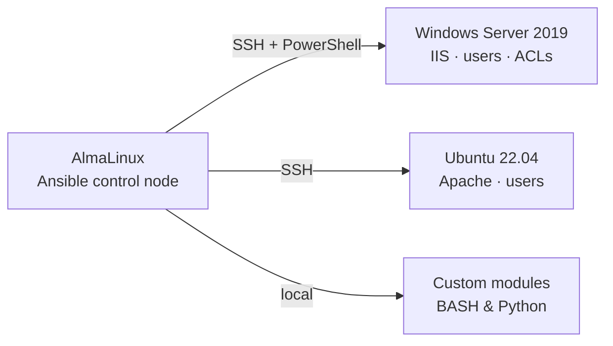

[delete_users.sh](https://github.com/user-attachments/files/33918147/delete_users.sh)# Ansible Automation for Windows & Linux ⚙️🤖
**Academic Project, ECPI University** | Infrastructure Automation | Mar – Apr 2026

## 📋 Overview
I used Ansible to automate administration of a mixed Windows and Linux lab from a single **AlmaLinux control node**. The playbooks manage a **Windows Server 2019** host over SSH with PowerShell and an **Ubuntu 22.04** host over SSH. They cover software installation, users and groups, NTFS permissions, web server deployment, and custom modules written in **BASH** and **Python**.

## 🗺️ Lab Architecture


## 🛠️ Technologies
`Ansible` `YAML` `ansible.windows` `community.general` `BASH` `Python` `PowerShell` `Windows Server 2019` `AlmaLinux` `Ubuntu` `IIS` `Apache` `SSH key authentication` `Ansible Vault`

## 📂 Repository Structure
```
├── ansible.cfg
├── inventory/
│   ├── hosts.example.ini           # Windows (SSH/PowerShell) and Ubuntu hosts
│   └── group_vars/all.example.yml  # Vault-encrypted variables go here
├── playbooks/
│   ├── windows/
│   │   ├── install_apache_win.yml    # Download and install an MSI package
│   │   ├── win_remove_apache.yml     # Uninstall the MSI package
│   │   ├── manage_windows_users.yml  # Users, group, folder, and ACL
│   │   ├── create_users_group.yml    # Local users added to a group
│   │   ├── create_folder_acl.yml     # Disable inheritance, apply custom ACL
│   │   └── install_iis.yml           # Install the IIS Web Server role
│   └── linux/
│       ├── create_users.yml          # Create users from CSV (custom module)
│       ├── reset_passwords.yml       # Reset passwords from CSV (custom module)
│       ├── delete_users.yml          # Delete users listed in a CSV on Ubuntu
│       ├── check_users.yml           # Check users with a custom Python module
│       ├── process_count.yml         # Count running processes
│       ├── install_apache.yml        # Install and start Apache
│       └── deploy_site.yml           # Deploy a custom web page
├── library/
│   ├── add_user.sh                   # Custom BASH module: create a user
│   ├── reset_password.sh             # Custom BASH module: reset a password
│   ├── delete_users.sh               # Custom BASH module: delete users from CSV
│   └── check_user.py                 # Custom Python Ansible module
├── data/                             # Sample CSV input files
└── screenshots/
```
# Copy to hosts.ini and replace the example IPs and usernames with your own lab values.

[windows]
win2019 ansible_host=192.168.1.2
[windows:vars]
ansible_connection=ssh
ansible_shell_type=powershell
ansible_user=ansible_user
[ubuntu]
ubuntu-host ansible_host=192.168.1.3 ansible_user=ansible_user

# Copy to inventory/group_vars/all.yml and encrypt it:
#   ansible-vault encrypt inventory/group_vars/all.yml
# Never commit real passwords to Git.
windows_default_password: "CHANGE_ME"

[reset_passwords.yml](https://github.com/user-attachments/files/33918132/reset_passwords.yml)[install_iis.yml](https://github.com/user-attachments/files/33918143/install_iis.yml)
[create_users_group.yml](https://github.com/user-attachments/files/33918142/create_users_group.yml)
[win_remove_apache.yml](https://github.com/user-attachments/files/33918141/win_remove_apache.yml)
[install_apache_win.yml](https://github.com/user-attachments/files/33918140/install_apache_win.yml)
[create_folder_acl.yml](https://github.com/user-attachments/files/33918139/create_folder_acl.yml)
[manage_windows_users.yml](https://github.com/user-attachments/files/33918138/manage_windows_users.yml)
[deploy_site.yml](https://github.com/user-attachments/files/33918137/deploy_site.yml)
[install_apache.yml](https://github.com/user-attachments/files/33918136/install_apache.yml)
[process_count.yml](https://github.com/user-attachments/files/33918135/process_count.yml)
[create_users.yml](https://github.com/user-attachments/files/33918134/create_users.yml)
[check_users.yml](https://github.com/user-attachments/files/33918133/check_users.yml)
[delete_users.yml](https://github.com/user-attachments/files/33918131/delete_users.yml)
[Up[add_user.sh](https://github.com/user-attachments/files/33918148/add_user.sh)
loading delete_users.sh…]()
[usernames.csv](https://github.com/user-attachments/files/33918151/usernames.csv)
[users.example.csv](https://github.com/user-attachments/files/33918152/users.example.csv)
[U[defaults]


inventory = ./inventory/hosts.ini
library = ./library
host_key_checking = True
ploading ansible.cfg…]()
[Uploinventory/hosts.ini
inventory/group_vars/all.yml
*.retry
ading download…]()

## 🔧 What Each Part Does

### Windows Server automation
- **Software lifecycle:** downloads an MSI with `win_get_url`, then installs and removes it with `win_package`
- **Identity and access:** creates local users and groups with `win_user` and `win_group`, creates folders with `win_file`, disables inheritance with `win_acl_inheritance`, and grants Full Control with `win_acl`
- **Web server:** installs IIS with `win_feature`, verified by loading the default IIS page from the Linux control node

### Linux automation
- **Bulk user management:** reads a CSV with `community.general.read_csv` and loops over each row to create users, reset passwords, or delete accounts
- **Web deployment:** installs and enables Apache with `apt` and `service`, then deploys a custom `index.html`
- **System checks:** counts running processes and reports the result with `debug`

### Custom modules
- **BASH modules** (`add_user.sh`, `reset_password.sh`, `delete_users.sh`) wrap `useradd`, `chpasswd`, and `userdel` so playbooks can call them for each CSV row
- **Python module** (`check_user.py`) uses Ansible's `AnsibleModule` and the `pwd` library to return whether each user exists, without making changes (idempotent and check-mode safe)

## ▶️ How to Run
```bash
# 1. Install the collections
ansible-galaxy collection install ansible.windows community.general

# 2. Set up the inventory and secrets
cp inventory/hosts.example.ini inventory/hosts.ini
cp inventory/group_vars/all.example.yml inventory/group_vars/all.yml
ansible-vault encrypt inventory/group_vars/all.yml

# 3. Test connectivity
ansible windows -m ansible.windows.win_ping
ansible ubuntu -m ping

# 4. Run a playbook
ansible-playbook playbooks/windows/install_iis.yml --ask-vault-pass
ansible-playbook playbooks/linux/check_users.yml
```

## 🔐 Security Practices
- **No passwords in code:** the lab versions had passwords typed directly into playbooks and scripts. In this repository they come from **Ansible Vault** variables or a git-ignored CSV, and tasks that handle passwords use `no_log: true` so passwords never appear in output
- **SSH key authentication** from the control node to Windows, with no password prompt
- **Least privilege:** `become` is used only in playbooks that need root

## 📸 Results

| Connectivity to Windows and Ubuntu | IIS installed on Windows Server |
|---|---|
|  |  |

| Users, groups, and ACLs on Windows | Custom Python module results |
|---|---|
|  |  |

| Apache deployed on Ubuntu | ACL verified on C:\ECPI |
|---|---|
|  |  |

More in the [screenshots](screenshots/) folder.

## 💡 Skills Demonstrated
Infrastructure as Code · Configuration management · Windows and Linux administration · Identity and access management · Writing custom Ansible modules · BASH and Python scripting · Secrets management · Idempotent automation
