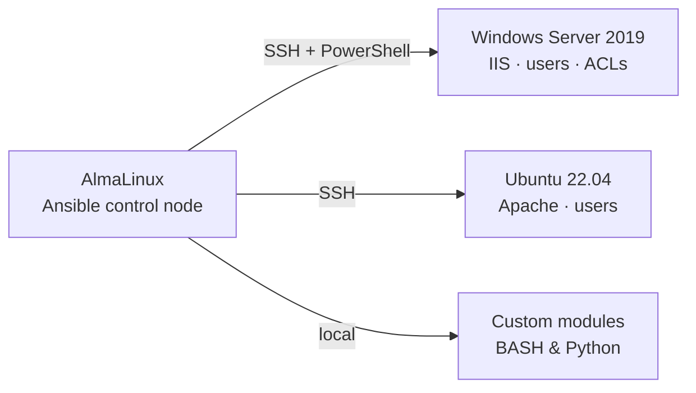
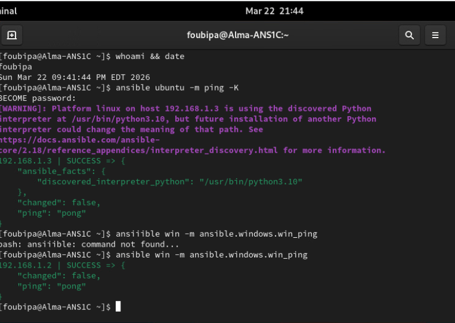
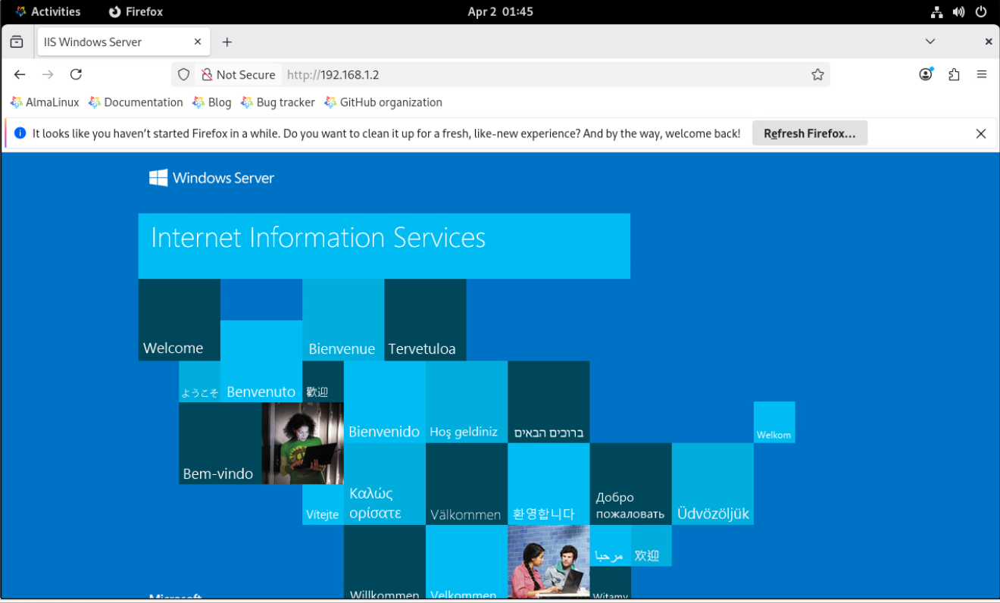
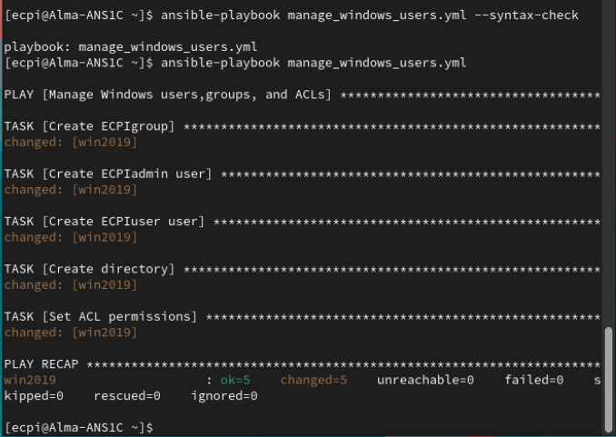
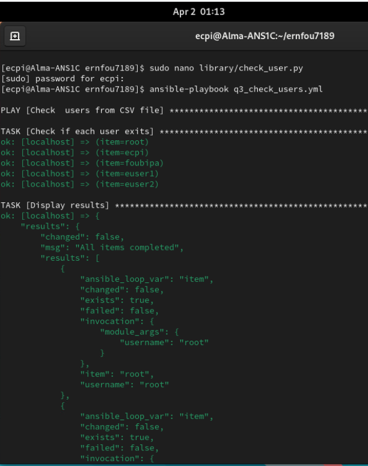
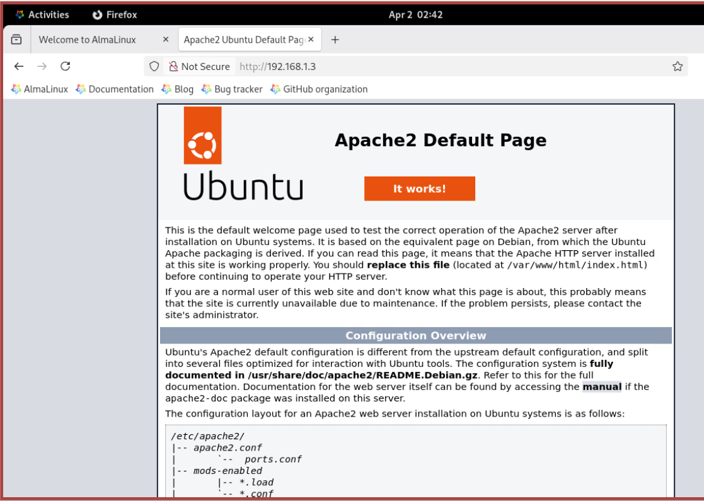
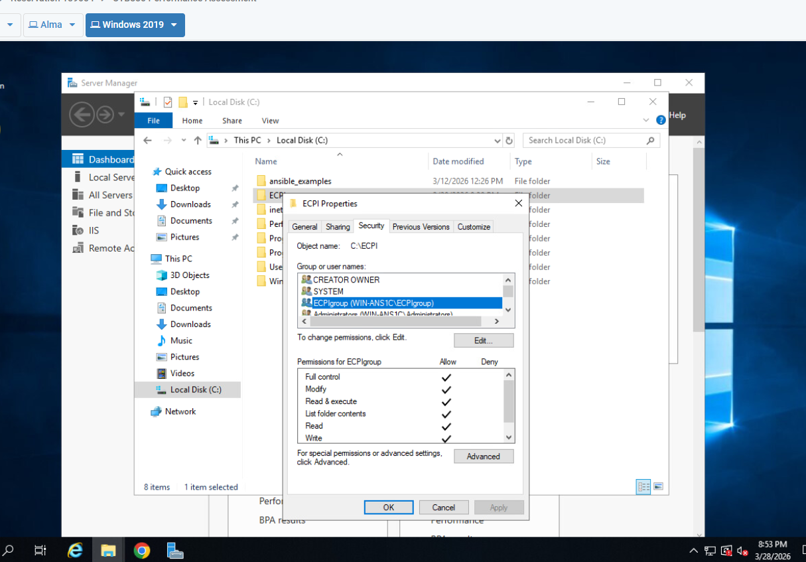

# Ansible Automation for Windows & Linux ⚙️🤖
**Academic Project, ECPI University** | Infrastructure Automation | Mar – Apr 2026

## 📋 Overview
I used Ansible to automate administration of a mixed Windows and Linux lab from a single **AlmaLinux control node**. The playbooks manage a **Windows Server 2019** host over SSH with PowerShell and an **Ubuntu 22.04** host over SSH. They cover software installation, users and groups, NTFS permissions, web server deployment, and custom modules written in **BASH** and **Python**.

## 🗺️ Lab Architecture


## 🛠️ Technologies
`Ansible` `YAML` `ansible.windows` `community.general` `BASH` `Python` `PowerShell` `Windows Server 2019` `AlmaLinux` `Ubuntu` `IIS` `Apache` `SSH key authentication` `Ansible Vault`

## 📂 Repository Files
| Type | Files |
|---|---|
| **Windows playbooks** | `install_apache_win.yml` · `win_remove_apache.yml` · `manage_windows_users.yml` · `create_users_group.yml` · `create_folder_acl.yml` · `install_iis.yml` |
| **Linux playbooks** | `create_users.yml` · `reset_passwords.yml` · `delete_users.yml` · `check_users.yml` · `process_count.yml` · `install_apache.yml` · `deploy_site.yml` |
| **Custom modules** | `add_user.sh` · `reset_password.sh` · `delete_users.sh` (BASH) · `check_user.py` (Python) |
| **Configuration** | `ansible.cfg` · `hosts.example.ini` (inventory) · `all.example.yml` (Vault variables) |
| **Sample data** | `users.example.csv` · `usernames.csv` |
| **Evidence** | `*.png` screenshots |

## 🔧 What Each Part Does

### Windows Server automation
- **Software lifecycle:** downloads an MSI with `win_get_url`, then installs and removes it with `win_package`
- **Identity and access:** creates local users and groups with `win_user` and `win_group`, creates folders with `win_file`, disables inheritance with `win_acl_inheritance`, and grants Full Control with `win_acl`
- **Web server:** installs IIS with `win_feature`, verified by loading the default IIS page from the Linux control node

### Linux automation
- **Bulk user management:** reads a CSV with `community.general.read_csv` and loops over each row to create users, reset passwords, or delete accounts
- **Web deployment:** installs and enables Apache with `apt` and `service`, then deploys a custom `index.html`
- **System checks:** counts running processes and reports the result with `debug`

### Custom modules
- **BASH modules** (`add_user.sh`, `reset_password.sh`, `delete_users.sh`) wrap `useradd`, `chpasswd`, and `userdel` so playbooks can call them for each CSV row
- **Python module** (`check_user.py`) uses Ansible's `AnsibleModule` and the `pwd` library to return whether each user exists, without making changes (idempotent and check-mode safe)

## ▶️ How to Run
```bash
# 1. Install the collections
ansible-galaxy collection install ansible.windows community.general

# 2. Set up the inventory and secrets
cp hosts.example.ini hosts.ini
mkdir -p group_vars && cp all.example.yml group_vars/all.yml
ansible-vault encrypt group_vars/all.yml
cp users.example.csv users.csv   # then edit with real values

# 3. Test connectivity
ansible windows -m ansible.windows.win_ping
ansible ubuntu -m ping

# 4. Run a playbook
ansible-playbook install_iis.yml --ask-vault-pass
ansible-playbook check_users.yml
```

## 🔐 Security Practices
- **No passwords in code:** the lab versions had passwords typed directly into playbooks and scripts. In this repository they come from **Ansible Vault** variables or a git-ignored CSV, and tasks that handle passwords use `no_log: true` so passwords never appear in output
- **SSH key authentication** from the control node to Windows, with no password prompt
- **Least privilege:** `become` is used only in playbooks that need root

## 📸 Results

| Connectivity to Windows and Ubuntu | IIS installed on Windows Server |
|---|---|
|  |  |

| Users, groups, and ACLs on Windows | Custom Python module results |
|---|---|
|  |  |

| Apache deployed on Ubuntu | ACL verified on C:\ECPI |
|---|---|
|  |  |

More in the [screenshots]() folder.

## 💡 Skills Demonstrated
Infrastructure as Code · Configuration management · Windows and Linux administration · Identity and access management · Writing custom Ansible modules · BASH and Python scripting · Secrets management · Idempotent automation
